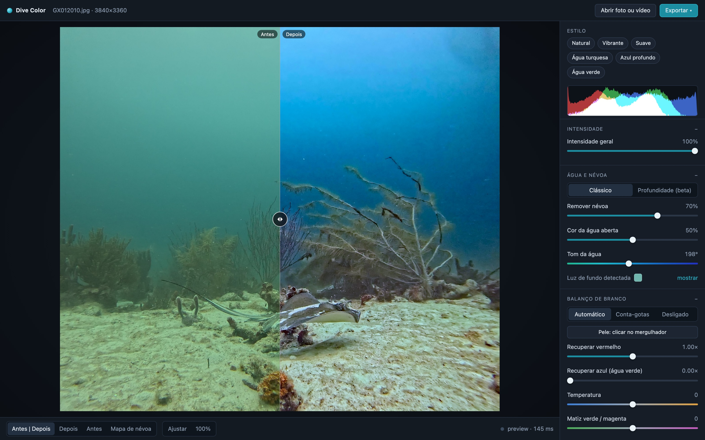

# Dive Color

Correção de cor para fotos e vídeos de mergulho, pensado principalmente para GoPro. Frontend em HTML/JS, processamento em Python (FastAPI + OpenCV + PyTorch + ffmpeg).



## Instalação

Requisitos:

- macOS, Linux ou Windows (WSL) com **Python 3.12** (3.13 também serve)
- **ffmpeg** para vídeo
- Opcional: **cmake** e **git**, para compilar o conversor de RAW da GoPro (`.GPR`)
- Opcional: GPU (Apple Silicon via MPS ou NVIDIA via CUDA). Sem GPU roda na CPU, mais devagar.

macOS (Homebrew):

```bash
brew install python@3.12 ffmpeg cmake
```

Ubuntu/Debian:

```bash
sudo apt install python3.12 python3.12-venv ffmpeg cmake git
```

Clone e rode:

```bash
git clone git@github.com:filipecaixeta/dive.git
cd dive
./run.sh
```

Na primeira execução o `run.sh` cria o `.venv`, instala as dependências do `requirements.txt` e compila o `gpr_tools` (se houver `cmake`). Os modelos de IA (Depth Anything V2, Grounding DINO, SAM 2) são baixados do Hugging Face na primeira vez que cada recurso é usado.

Abra http://localhost:8765, arraste uma foto ou vídeo e ajuste os controles. O preview atualiza enquanto você arrasta. Para usar outra porta: `PORT=9000 ./run.sh`.

## Estrutura

```
backend/     servidor FastAPI e motor de correção (numpy, PyTorch, vídeo, pele, RAW)
frontend/    interface (HTML/CSS/JS, sem build)
docs/        imagem do README
run.sh       cria o ambiente e sobe o servidor
```

Pastas criadas em tempo de execução e fora do git: `uploads/` (vídeos enviados), `output/` (vídeos exportados), `tools/` (gpr_tools), `media/` (fotos e vídeos locais de teste).

## O que entra

| Tipo | Formatos | Observação |
|---|---|---|
| Foto | JPEG, PNG, TIFF | 8 ou 16 bits |
| Foto RAW | **.GPR (GoPro)**, DNG, CR2/CR3, NEF, ARW, ORF, RW2, RAF | 16-bit linear, sem o balanço de branco da câmera. GPR passa pelo `gpr_tools` da GoPro (a LibRaw não decodifica o codec VC-5) |
| Vídeo | MP4, MOV (HEVC/H.264, 8 ou 10-bit) | GP-Log: carregue o LUT oficial da GoPro em "LUT de entrada" |

## O que sai

- Foto: JPEG 95 (4:4:4, EXIF preservado), TIFF 16-bit, LUT `.cube`.
- Vídeo: MP4 HEVC 10-bit (entrega) ou **MOV ProRes 422 HQ** (edição). Durante a exportação, o cartão de progresso mostra uma prévia ao vivo (o rastreamento do mergulhador e depois o frame final), atualizada a cada ~0,5 s. O codificador é escolhido pelo que existir: VideoToolbox no Mac, NVENC em GPU NVIDIA, libx265/prores_ks por software.

## Dois métodos de correção

- **Clássico** (padrão): estima a névoa pela cor (dark channel subaquático) e aplica um balanço de branco por cena. Rápido, robusto, sem IA.
- **Profundidade (beta)**: estima a distância de cada ponto com o Depth Anything V2 e aplica o modelo físico do Sea-thru (Akkaynak & Treibitz, 2019): névoa e perda de cor calculadas por distância. Adaptações para GoPro grande-angular: mapa de névoa por posição (vinheta e gradiente de luz), detecção de água pela cor e evidência de névoa para objetos distantes. Cores neutras mais fiéis e planos médios mais limpos; ainda erra em estruturas translúcidas e pode fechar demais as sombras.
  Variáveis: `DIVE_DEPTH_MODEL=Small|Base|Large` (padrão Base), `DIVE_DEPTH_INPUT` (resolução de entrada, padrão 756).

## Pele dos mergulhadores (backend/skin.py, backend/skin_track.py)

- Botão **"Pele: clicar no mergulhador"** (seção Balanço de branco). O clique escolhe o mergulhador; o Grounding DINO acha o corpo e as partes com pele (rosto, braços, pernas, mãos) e o SAM 2 recorta o contorno. Se o detector não reconhecer, o app recorta o que foi clicado e avisa.
- A correção leva o **matiz** da pele para a linha da pele do vetorscópio (~123°, a mesma para qualquer etnia), mantendo brilho e saturação: não clareia pele escura. É aplicada no mergulhador inteiro (mesma distância = mesma perda de cor): cheia na pele, metade no resto, quase nada no equipamento preto. Controle "Correção de pele".
- A máscara de cada mergulhador tem borda suavizada e pode ser vista e ajustada: modo **"Máscara"** na barra de visualização (rosa = onde e quanto a correção atua), **"Suavidade da borda da máscara"** e **"Só a pele ↔ mergulhador inteiro"** (padrão no meio: no extremo "inteiro", o equipamento preto tende a avermelhar).
- Vários mergulhadores por imagem (um clique cada). Primeiro clique ~15 s (carrega os modelos), depois alguns segundos.
- **Vídeo:** os mergulhadores marcados no frame da tela são seguidos pelo vídeo (SAM 2 em fluxo, 5 amostras/s, para frente e para trás, parando quando o mergulhador some). A cor da pele é medida a cada amostra e suavizada no tempo. No M1 Pro, ~10 s de rastreamento por segundo de vídeo em que o mergulhador aparece.
- Limites: correção sutil quando quase não há pele visível; mergulhador que sai e volta muito depois pode não ser reencontrado; só os mergulhadores marcados no frame atual entram na exportação.

## Motor na GPU (backend/engine_torch.py)

- PyTorch: MPS no Mac, CUDA em NVIDIA, CPU como último recurso. `DIVE_GPU=0` força o motor numpy.
- Estatísticas (balanço de branco, níveis, ajustes do Sea-thru) continuam no numpy em 640 px. Mapas que não dependem dos controles e usam morfologia elíptica do OpenCV também, uma vez por imagem.
- O motor numpy (`engine.py`) é a referência. `backend/tests/test_engines.py` compara os dois (60 dB hoje; falha abaixo de 45 dB): `.venv/bin/python backend/tests/test_engines.py foto.jpg`.

| No M1 Pro | numpy | GPU |
|---|---|---|
| Rascunho ao arrastar (760 px) | ~110 ms | ~20-40 ms |
| Preview (1800 px) | ~450 ms | ~90-160 ms |
| Preview, método profundidade | ~1500 ms | ~190 ms |
| Exportar vídeo 4K (46 s) | ~9 min (2,7 fps) | ~4 min (5,7 fps) |

No vídeo, o limite passa a ser a própria GPU do M1 Pro (~170 ms de cálculo por frame em 4K). O caminho híbrido (conversões e mapas na CPU em paralelo, cálculo pesado na GPU) foi o mais rápido; todo na GPU ficou mais lento porque operações inteiras e transferências são caras no MPS e nada se sobrepunha.

## Como funciona o preview em tempo real

- Ao abrir a foto, o servidor guarda versões dela em 640, 760, 1024 e 1800 px, além da original.
- O que não depende dos controles (luz de fundo, mapa de névoa, separação base/detalhe) é calculado uma vez e fica em cache.
- Enquanto você arrasta um controle, o frontend pede um rascunho em 760 px (~110 ms). Sempre fica no máximo uma requisição em andamento, levando os parâmetros mais recentes.
- Quando você solta (ou para por ~0,3 s), ele pede a versão de 1800 px (~0,5 s).
- Exportar processa a resolução original com as mesmas estatísticas, então o arquivo final bate com o preview.

## Pipeline (backend/engine.py)

1. **Luz de fundo**: busca em quad-tree pela região de água aberta (lisa, azul/verde, sem vermelho).
2. **Remoção de névoa**: dark channel subaquático (só G e B) com abertura morfológica, para não criar halo em ramos finos, refinado com filtro guiado. A inversão é feita só na camada base, então o ruído da água não é amplificado.
3. **Recuperar vermelho/azul**: compensação de canal a partir do verde (Ancuti et al.).
4. **Balanço de branco**: automático (shades-of-gray ponderado pelo primeiro plano) ou conta-gotas.
5. **Cor da água**: a água aberta vai para um tom de azul escolhido em vez de virar cinza.
6. **Níveis, exposição, ombro suave nos realces, curva S**.
7. **Contraste local** com filtro que respeita bordas, reduzido na água aberta.
8. **Vibração/saturação**, redução de ruído (mais forte na água), nitidez com limiar.
9. **Intensidade geral**: mistura com o original.

## Vídeo (backend/video.py)

- Ao abrir um vídeo, ele vai para `uploads/` e um frame vira uma sessão de edição normal. A linha do tempo troca o frame usado para ajustar.
- **Cor adaptativa** (padrão): na exportação, ele analisa ~2 frames por segundo, calcula as estatísticas da correção (luz de fundo, balanço de branco, níveis) em cada um e suaviza no tempo (mediana + gaussiana de ~1 s). A correção acompanha a mudança de cena sem piscar.
- **Fixa neste frame**: usa a correção do frame na tela no vídeo inteiro.
- Render: cada frame é lido em RGB 16-bit, o pipeline completo roda em 1280 px, e a correção é transferida para a resolução original como uma transformação de cor local 3x4 (guided filter colorido). Mantém todo o detalhe original, fica a ~35 dB do processamento direto em resolução máxima e é ~4x mais rápido. 6 frames em paralelo.
- Saída: HEVC 10-bit (VideoToolbox), BT.709, áudio copiado, bitrate equivalente ao original. Vai para `output/`.
- No M1 Pro, o vídeo de exemplo (46 s, 3840x3360, 30 fps) leva cerca de 8 a 9 minutos.
- A conversão YUV→RGB declara a faixa e a matriz do arquivo. O padrão do ffmpeg (BT.601) desloca o matiz.

## Exportação

- JPEG qualidade 95, 4:4:4, com EXIF e perfil de cor preservados.
- TIFF 16-bit.
- LUT `.cube` 33³ para vídeo (DaVinci, Premiere, Final Cut). Contém só a parte global da correção. Remoção de névoa e contraste local dependem da posição do pixel e não cabem num LUT.
